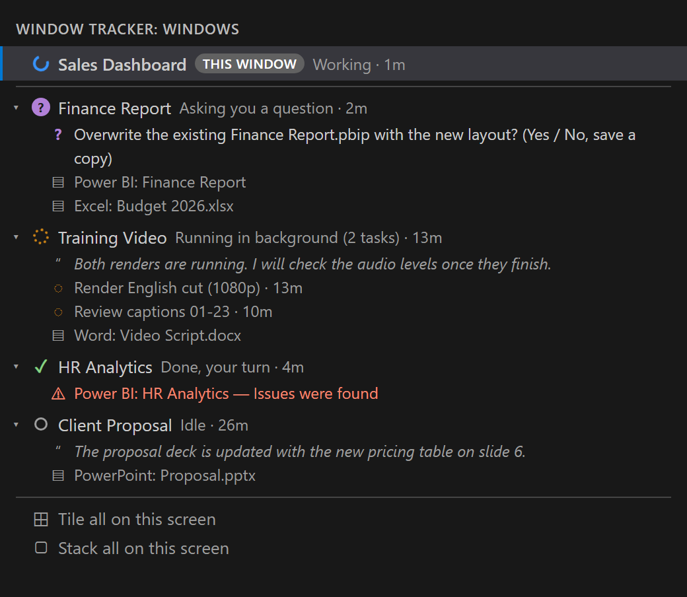

# DataTale Window Tracker

**Run several Claude Code sessions across VS Code windows without losing track of them.**

If you work on three or four projects at once, each in its own VS Code window with Claude Code, you spend a lot of time clicking between windows to see which one is waiting on you. Window Tracker adds a panel to every window that shows all of them at a glance. Click one to jump straight to it.

## What it shows

| Icon | Meaning |
|---|---|
| purple **?** | Claude is asking you a question |
| red **!** | Claude needs your permission or input |
| green **✓** | Claude has finished, your turn |
| blue spinner | Claude is working |
| orange dotted spinner | Claude has finished its turn but left background jobs or agents running |
| grey circle | Idle, or no Claude session |

- **This window is always on top**, highlighted, so you know where you are.
- **Windows that need you sort to the top.** The activity bar badge and a **🔔 2 waiting** status bar item count them. Click the status bar item to go to the next one.
- **Pop-ups** tell you when another window asks a question, needs permission, or its background work finishes.

## Details under each window

Click **▸** to expand a window. Windows expand on their own when Claude is asking something.

- **What Claude said:** its question or permission request, or the start of its last reply. You can see what it wants without switching.
- **Background jobs by name**, for example "Render English cut (1080p) · 13m".
- **Open documents from that project:** Power BI Desktop reports, Word, PowerPoint and Excel files. Click one to bring its window forward. A ⚠ warning appears if one stops responding, or if Power BI shows an error dialog such as "Issues were found". *(Windows only.)*

## Jump straight into the chat

Clicking a window brings it to the front **and puts the cursor in its Claude Code chat box**, ready to type. Turn this off with `vsTracker.focusClaudeInput`.

## Layouts *(Windows only)*

- **Tile all on this screen** arranges every window in a grid on the current monitor.
- **Stack all on this screen** maximises them all on the current monitor; switch between them from the panel.
- `Ctrl+Alt+L` toggles between the two.

## Getting started

1. Install the extension.
2. When asked, click **Install hooks**, or run **Window Tracker: Install Claude Hooks** from the Command Palette.
3. Restart any Claude Code sessions that were already running, so they pick up the hooks.

### Requirements

- [Claude Code](https://claude.com/claude-code), in the VS Code extension or the terminal
- Node.js on your PATH (Claude Code runs the status hook with `node`)
- Windows for the document list and layouts. Status tracking and window switching are written to work on macOS and Linux too, but have only been tested on Windows.

## Privacy

Everything stays on your computer. Nothing is sent anywhere.

- **Install Claude Hooks** adds one small hook to `~/.claude/settings.json`, alongside any hooks you already have. It saves a backup of the file first, and **Remove Claude Hooks** takes it out again.
- The hook writes each session's status to `~/.vs-tracker/`. To show Claude's last reply and background jobs, the extension reads your local Claude Code transcripts.
- To list open documents, it asks Power BI Desktop and Office which files are open, on your machine only.

## Settings

| Setting | Default | |
|---|---|---|
| `vsTracker.notify` | `true` | Pop-up when another window starts waiting on you |
| `vsTracker.focusClaudeInput` | `true` | Put the cursor in Claude's chat box when switching windows |

## About

Built by [DataTale](https://datatale.com.au), Power BI and data consulting, to manage a day of parallel Claude Code sessions. Not affiliated with Anthropic or Microsoft. MIT licensed.
